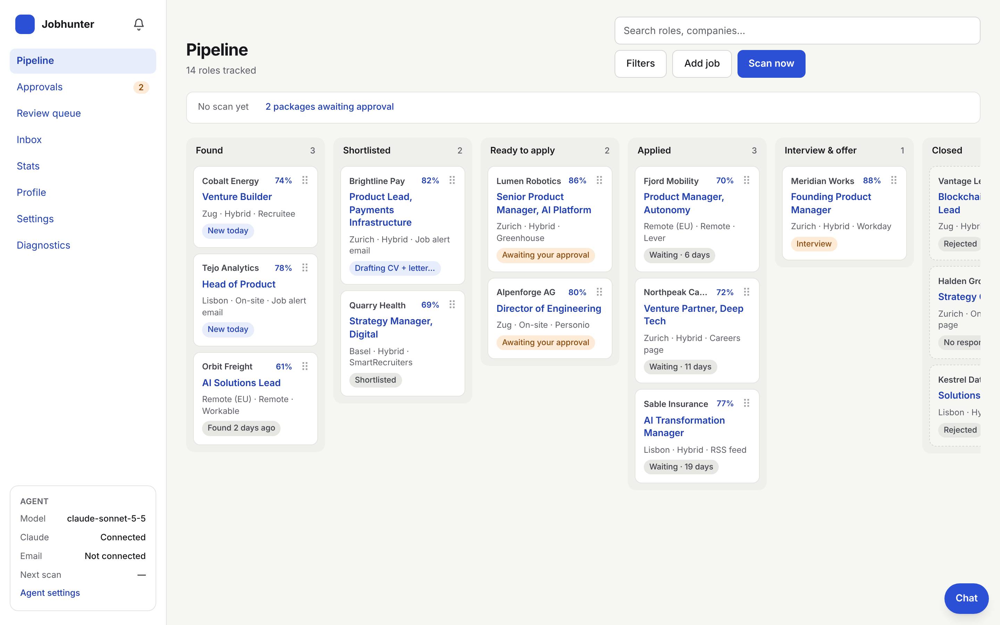
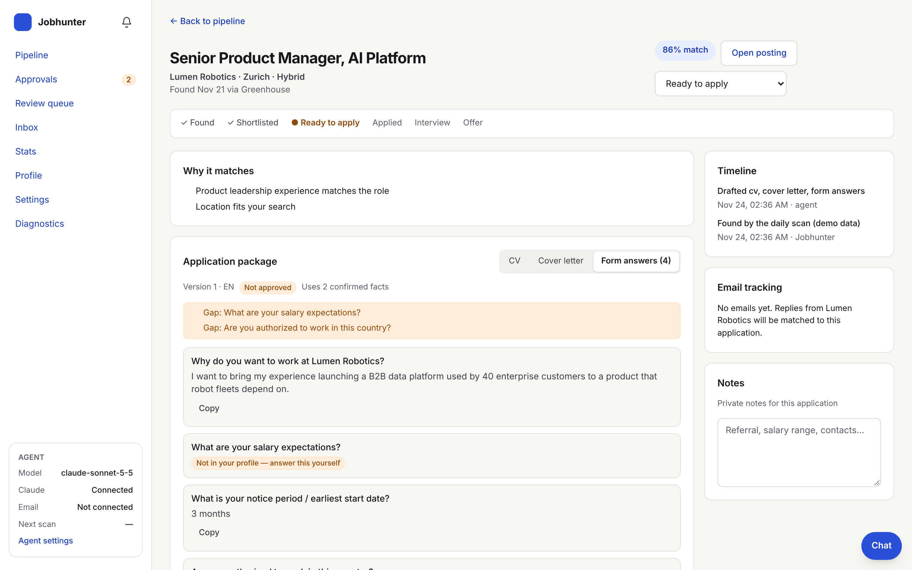
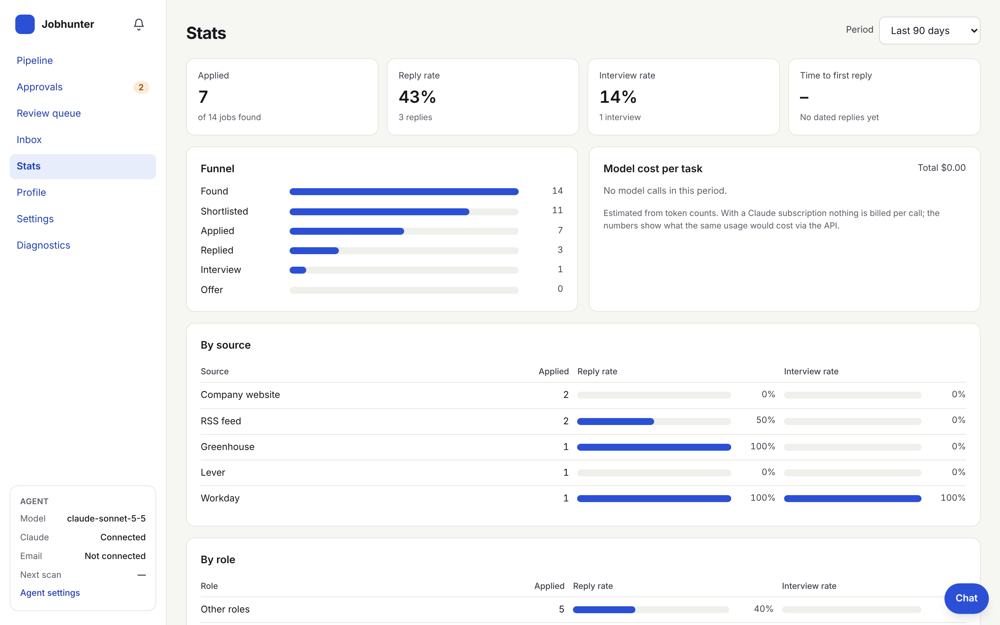
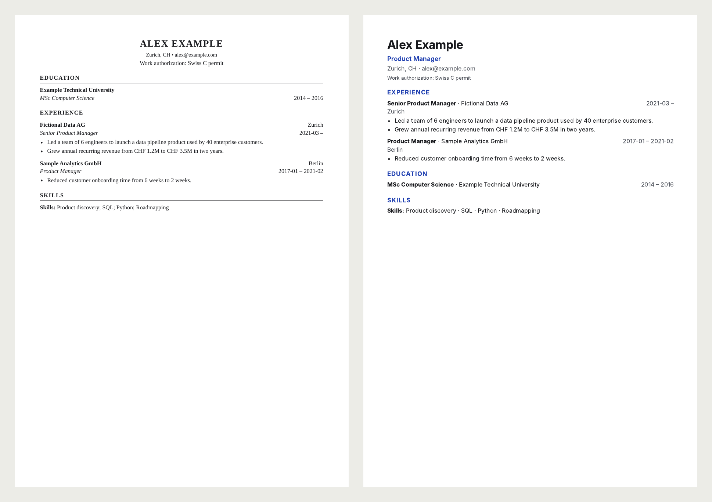
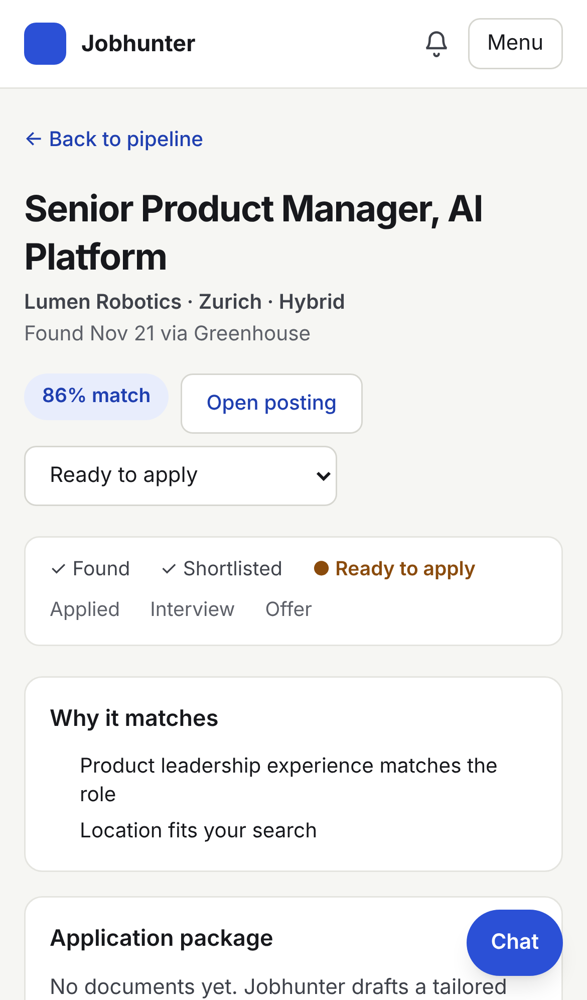

# Jobhunter

An open-source, local-first job-search assistant. Jobhunter finds jobs that fit you, writes a tailored CV and cover letter for each one from facts you confirmed, helps you apply, and keeps your pipeline up to date by reading the replies in your inbox. It runs on your computer (or your own server) with your own Claude account. There is no Jobhunter cloud, no account and no telemetry.



| Application package | Statistics |
|---|---|
|  |  |

| CV styles (Harvard and Modern) | On a phone |
|---|---|
|  |  |

## What it does

- **Your profile, truthfully.** Import your CV (PDF or DOCX), answer a short interview (type or speak), and confirm the facts. Every CV line, letter paragraph and form answer cites the facts it uses; numbers, employers, titles and dates are checked against your profile, and anything missing is flagged instead of invented.
- **Finds jobs every day.** It watches company career pages and job boards (Greenhouse, Lever, Ashby, SmartRecruiters, Workable, Recruitee, Personio, Workday, RSS, Arbeitnow) plus the job-alert emails you already get, including LinkedIn alerts. Postings are deduplicated and scored against your search profile with reasons and gaps. A weekly discovery agent suggests new companies for you to accept or reject.
- **Writes the application.** Tailored CV, cover letter and answers to common form questions, in the posting's language or yours, in your writing style (it learns from your edits). Four CV styles, including the Harvard Business School format, with conventions for Switzerland, Germany, Portugal, Spain, France, the UK, the US and Mexico. Text-selectable PDFs.
- **Helps you apply.** By default it only *prepares*: it fills the form and hands it to you. You can allow automatic submission for high matches, within a daily cap. It always stops at CAPTCHAs, logins, two-factor prompts, payment fields and unknown questions, and keeps a screenshot of everything it submits.
- **Tracks replies.** It reads your Gmail (your own OAuth client, or IMAP with an app password), recognises confirmations, rejections, interview invitations and offers in six languages, updates the board, and puts anything uncertain in a review queue. It never sends email.
- **Everything else:** a chat that answers questions and proposes changes for you to confirm, notifications, stats (funnel, reply rates by source and role, time to first reply, model cost per task), a monthly budget, a diagnostics page, export and delete-everything. The UI is in English, German, Portuguese, Spanish and French, with light and dark themes, and works on a phone.

## Quick start

### Desktop (macOS, Windows, Linux)

Download the installer from [Releases](https://github.com/Pizajolo/Jobhunter/releases), open it and follow the onboarding. The builds are not code-signed yet, so macOS and Windows will warn you the first time ([how to open it](docs/PACKAGING.md#code-signing)). On first start Jobhunter downloads Chromium (about 150 MB), which it uses for PDFs and applying. The app keeps running in the tray so the daily scan happens while your computer is awake.

### Server (Docker)

```bash
git clone https://github.com/Pizajolo/Jobhunter.git && cd Jobhunter
```

```bash
cp docker/.env.example docker/.env
```

Set `JOBHUNTER_MASTER_KEY` in `docker/.env` (`openssl rand -base64 32`), then start it:

```bash
docker compose -f docker/docker-compose.yml up -d --build
```

It listens on `127.0.0.1:4317` only. Reach it through an SSH tunnel, Tailscale or a TLS reverse proxy. See [docs/SERVER.md](docs/SERVER.md) for the first password, the Claude login and backups.

### From source

Requires Node 22 and pnpm 10.

```bash
pnpm install
```

```bash
pnpm --filter @jobhunter/web build && pnpm --filter @jobhunter/engine build
```

```bash
JOBHUNTER_WEB_DIST=apps/web/dist node apps/engine/dist/main.js
```

Then open http://127.0.0.1:4317. For a desktop window instead: `pnpm --filter @jobhunter/desktop start`.

## Your Claude account

Jobhunter uses Claude through your own account: your **Claude subscription** through the official Claude Code login (the default), an **Anthropic API key**, or an Anthropic-compatible provider. It never collects, stores or reads your Claude credentials. Read [docs/CLAUDE_ACCOUNT.md](docs/CLAUDE_ACCOUNT.md) before choosing. It quotes Anthropic's current terms on third-party use of subscription logins and covers costs.

## Honest limitations

- **No LinkedIn automation, ever.** Jobhunter never visits, scrapes or applies on LinkedIn. LinkedIn jobs reach it only through the job-alert emails LinkedIn sends you, and linkedin.com is permanently excluded from automatic applying. You apply there yourself.
- **CAPTCHAs, logins and 2FA stop the agent.** It never tries to get around bot protection and never types your portal passwords. You finish those steps yourself, in the application browser, which remembers your own logins.
- **You are responsible for what is submitted.** Read the package before approving it. Automatic submission is off by default, and even when on it is limited by score, a daily cap and an exclusion list.
- **Accuracy depends on the model.** The tests run against recorded model answers. The email-classification target (90 % or better) has not been measured with a live model in this release; run `pnpm eval:email --live` with your own account to check it.
- **Real application forms vary.** Applying is tested against mock Greenhouse, Lever, Ashby and Workday forms. Custom widgets on real portals are often left for you.
- **In server mode, "prepare" can't hand a half-filled form to your phone.** You get a screenshot, the posting link and copyable answers instead.
- **The apply browser is a separate window** on desktop, not embedded in the app.
- **Gmail only** for email tracking in v1 (Outlook is planned behind the same interface).

## Documentation

| Guide | |
|---|---|
| [CLAUDE_ACCOUNT.md](docs/CLAUDE_ACCOUNT.md) | Subscription login, API key, other providers, costs |
| [GMAIL_OAUTH.md](docs/GMAIL_OAUTH.md) | Your own Google Cloud OAuth client for the Gmail API |
| [GMAIL_IMAP.md](docs/GMAIL_IMAP.md) | The simpler alternative: IMAP with an app password |
| [SERVER.md](docs/SERVER.md) | Docker, sign-in, Tailscale or reverse proxy, backups, updates |
| [PRIVACY.md](docs/PRIVACY.md) | What is stored where, what is sent to whom, export and delete |
| [ADDING_A_SOURCE.md](docs/ADDING_A_SOURCE.md) | Writing a new job-source adapter |
| [MCP.md](docs/MCP.md) | Using your pipeline from Claude Desktop or other MCP clients |
| [PACKAGING.md](docs/PACKAGING.md) | Building installers and releasing |

## Development

```
apps/engine      Fastify engine: scheduler, scanning, agents, email, applying, REST + WebSocket API
apps/web         React UI (Vite, Tailwind, TanStack Query, i18next)
apps/desktop     Electron shell: engine in a utility process, tray, notifications
packages/shared  Types, schemas, status machine, settings
packages/db      SQLite schema and migrations (Drizzle)
packages/mcp-*   Job sources, email, documents, browser and pipeline tools
fixtures/        Recorded HTTP responses, model answers, emails, mock application forms
```

| Command | Runs |
|---|---|
| `pnpm test` | unit and integration tests |
| `pnpm test:prompts` | every prompt against recorded answers (`--live` / `--record` with your account) |
| `pnpm eval:email` | email-classification accuracy on 55 synthetic emails in six languages |
| `pnpm e2e` | Playwright tests of the UI and the mock application forms |
| `pnpm --filter @jobhunter/engine demo` | the app with demo data and offline model answers |

No test makes a live model call or touches a real job site. [docs/PLAN.md](docs/PLAN.md) explains the architecture, and [docs/PROGRESS.md](docs/PROGRESS.md) lists what is done and what is known not to work yet.

## License

[MIT](LICENSE)
